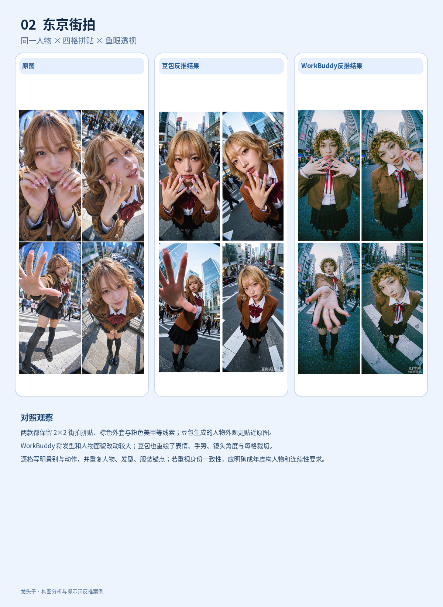
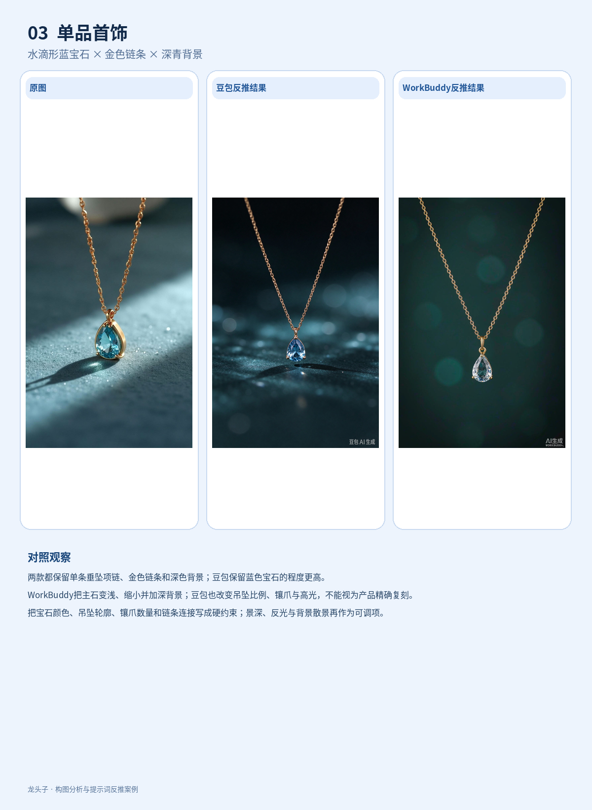

# 龙头子｜构图分析工作台与提示词反推 Skill

这是一个免费开源的构图分析项目。公开包只保留一份用户可打开的整合工作台：蓝色毛玻璃界面，默认进入「最新判读」，并在同一页面提供参考图库、工具说明、本地图片分析和「关于我」。

## 快速使用

- 直接用浏览器打开 `构图分析工作台.html`，查看 168 张参考图库和 8 张静态判读案例。
- 网页上传图片只运行旧版 17 类本地规则；它不会自动调用 AI。
- 需要 21 类视觉判读或反推提示词时，在支持图片输入的 AI 对话中安装 `composition-analysis/`，附上图片并提出分析要求。需要把结果写进网页时，宿主还需能读写本地文件并运行 Python。
- `engine_base.html` 是渲染模板，日常只打开 `构图分析工作台.html`。独立静态图库等旧页面没有放入本包。

## 安装 Skill

将 `composition-analysis/` 整个目录放进目标 AI 工具的技能目录，按该工具的 Skill 安装方式启用。若工具只支持文本附件，可在对话中附图并提供 `SKILL.md` 和 `references/` 中的判断卡；本地标注与更新工作台还需要 Python/Pillow 和工作区读写能力。不同工具的安装入口与文件写入能力不同，不能仅凭本包保证每个平台都能运行完整流程。

## GitHub 上传

1. 解压本包，打开 `composition-analysis-workbench/`。
2. 在 GitHub 创建一个空仓库；此文件夹已经包含 README、许可证和 `.gitignore`，创建时不要再自动添加同名文件。
3. 用 GitHub Desktop 将该文件夹作为本地仓库，提交并推送。
4. 只上传本公开包。8 张判读案例已嵌入工作台；不要把发布私钥放进仓库。

## 许可与素材

代码和原创文档按 Apache-2.0 许可。图库里的 Wikimedia Commons 图片须遵守各自的许可与署名条件；项目 AI 原创教学图不标作 CC 授权。作者提供的头像、微信搜索图与十八的照片仅用于工作台介绍，不随 Apache-2.0 许可授权。详见 `NOTICE` 和 `composition-analysis/assets/gallery/来源与授权清单.csv`。

本版「最新判读」页保留在首位，并预置 8 张作者确认可公开展示的静态案例。它们不代表网页能自动调用 AI；新增公开案例前仍须确认图像、肖像、品牌和文字素材的使用权。

## 提示词反推案例说明

提示词反推不是找回原图作者输入的真实 prompt，而是根据画面中能观察到的信息，重新整理主体、构图关系、镜头视角、光线、材质和色彩，写成一条新的、可继续使用的生成描述。

下面三组案例依次展示原图、豆包生成结果和 WorkBuddy 生成结果。建议按主体与位置、画面分区、色彩与光线、细节变化的顺序观察。对照重点是看哪些画面线索被保留、哪些细节发生了偏移，以及提示词还能补充哪些约束。

### 01｜珠宝静物

两款结果都保留珠宝、缎面与浪漫粉色氛围；主宝石的颜色、数量、切面和排列方式都有变化。提示词可进一步写清各主宝石的位置与颜色，以及缎面走向、花枝位置和小配饰密度。


### 02｜东京街拍

两款结果都保留了四格街拍、棕色外套和粉色美甲等线索。豆包生成的人物外观更接近原图；WorkBuddy 对发型和面貌的改动较大。若需要人物在多格之间保持连续，应重复说明人物与服装特征，并逐格描述动作和取景。



### 03｜单品首饰

两款结果都保留了垂坠项链和深色背景；豆包保留蓝色宝石的程度更高。两款结果中的吊坠比例、镶爪和高光仍有差异，因此这类图适合用来观察构图与风格，不应视为产品结构的精确复刻。



这些图片用于展示视觉差异，不是统一提示词、参数和随机种子下的标准化模型测评。不同工具的结果会受输入提示词、生成参数和随机性的影响。

## 验证发布文件

在包根目录运行：

```bash
python composition-analysis/scripts/verify_release_signature.py --expected-fingerprint 4afe3254c3e9aefea74ee83260de1a6d2a0ac3ee586b38d360fbdb4bf0370829
```

SHA-256 清单和数字签名用于确认文件来源及签署后是否发生变化，不会阻止查看、复制或修改。私钥不在公开包内。
